# verifa11y

**verifa11y audits HTML for accessibility violations, writes a concrete patch for each one, applies it to a copy,
re-audits, and keeps only the patches that provably fixed the violation without breaking anything else.** The result
is a standard `.patch` you can `git apply` and put in a pull request, plus a report of everything that was fixed,
rejected, or left for a human, and why.

Auditors like axe and Lighthouse stop at detection. verifa11y closes the loop to the fix, and does not trust itself:
every patch, whether it comes from a deterministic codemod, a model, or **any AI agent you plug in**, goes through the
same verifier. The verifier checks more than axe does: it compares the browser's accessibility tree, the keyboard
focus order and the rendered pixels before and after each patch.

> **Scope, up front.** verifa11y **patches static HTML files on disk**. It can also **crawl and audit a live site**
> (`verifa11y site`), with scripts running, but site mode only reports: a live page has no source file to patch.
> Templates and JavaScript frameworks are not patched (roadmap phase 2). See [Limitations](#limitations).
>
> **verifa11y does not guarantee WCAG conformance.** "Verified" means the checks below found the violation gone and
> nothing else worse. It is not a human review.
>
> **No telemetry, no account, no server.** The only network traffic is the page under audit and, only if you
> configure one, the model or agent that writes tier-1 patches.



Recorded from real runs by [`scripts/record-demo.mjs`](scripts/record-demo.mjs) (`npm run demo:record`); only the
pauses are shortened. The same session for asciinema: [`docs/demo.cast`](docs/demo.cast). The patch it writes:
[`demo/after/verifa11y.patch`](demo/after/verifa11y.patch).

## Results, including the uncomfortable ones

95 pages, 1,400 violations, every patch through the full verifier. Precision is measured **against the verifier, not
against a person**, with 95% Wilson intervals. The corpus has two sets: 73 **eval** pages that no one has tuned
anything on (quote these), and 22 **dev** pages that were read and debugged while the codemods were written
([held-out rule](corpus/README.md#held-out-rule)).

| Who writes the patches | Set | Proposed | Verified | Precision vs the verifier | Fix rate | Report |
|---|---|---:|---:|---|---:|---|
| Tier 0: codemods (offline, no model) | eval | 18 | 18 | 100% [82.4–100] | 2.4% | [bench/codemod](bench/codemod/report.md) |
| | dev | 136 | 136 | 100% [97.3–100] | 20.5% | |
| Naive baseline: unchecked quick fixes (a strawman, on purpose) | eval | 736 | 619 | 84.1% [81.3–86.6] | 83.9% | [bench/baselines/naive](bench/baselines/naive/report.md) |
| | dev | 653 | 403 | 61.7% [57.9–65.4] | 60.9% | |
| Tier 1: a real model | | not measured yet | | | | [report.md](report.md) |

The eval set is mostly one rule: 677 of its 738 violations are `color-contrast`, which tier 0 never touches, and three
pages hold 547 of the 738. Tier 0's eval precision rests on 18 patches, an interval of 82–100%. The intervals also
assume independent findings, and violations repeated by one stylesheet across a table are not, so read them as
narrower than they should be. The rest of this section is about the dev pages, where the rule-by-rule analysis was
done.

Read the second row carefully. The [naive fixer](bench/baselines/naive-fixer.mjs) gets **more** patches verified than
the codemods, and many of them are patches a reviewer would reject: `aria-checked="false"` invented for a checkbox
whose state is unknown, `aria-live="loud"` removed instead of corrected, `style="color: #000000"` on 169
elements. None of them makes the page worse for assistive technology, which is what the verifier can prove; several
do not make it better. So:

- **"Verified" is an upper bound, not a grade.** The verifier proves "nothing got worse", not "this is what the
  author meant". Tier 0 is at 100% because its codemods decline those cases, not because the verifier would catch
  them. Every patch still needs a human review before merge.
- **The verifier still earns its place.** Of the naive fixer's 653 patches it rejected 250 (38.3%) that a pipeline
  without it would have shipped as fixed; re-running axe alone would have let 223 of them through:

  | Verifier | Naive patches it would ship | Of those, rejected by the full verifier |
  |---|---:|---|
  | none (shape validation only) | 653 | 250 (38.3% [34.6–42.1]) |
  | axe only | 626 | 223 (35.6% [32–39.5]) |
  | axe + source checks | 407 | 4 (1.0% [0.4–2.5]) |
  | full (+ accessibility tree, focus order, pixels) | 403 | 0 |

- **Small samples are small.** Tier 0's 100% rests on n=122 for `aria-allowed-attr`; for `label` it is 5 of 5,
  an interval of 57–100%. Every report prints n and the interval per rule.

The [analysis](bench/baselines/naive/report.md#analysis) goes rule by rule. Two gaps it found were closable without
judgment and are now suspicion checks ([ADR 0015](docs/adr/0015-identifier-labels-and-dangling-id-references.md)):
an `aria-label` that only restates the field's `name` or `id` (`aria-label="first"`), and an id reference to no
element (`aria-controls="false"`). They moved 56 naive patches from verified to suspicious and flagged no tier-0
patch.

### A rejected patch

What the verifier says about the alt text a hurried fixer writes (from the demo above, `verifa11y verify`):

```json
{
  "findingId": "f_0005",
  "ruleGone": true,
  "newViolations": [],
  "suspicious": true,
  "reason": "text alternative \"plot map\" only restates the file name \"plot-map.png\"; accessibility tree:  (line 30) has a name that only restates its file name: \"plot map\"",
  "status": "rejected_suspicious",
  "flaggedBy": ["static", "accessibility-tree"]
}
```

axe is satisfied (`ruleGone: true`, nothing new); the patch is rejected anyway, and the reason says why.

## Why

Web accessibility is a legal obligation in more and more places (the European Accessibility Act, the ADA, with WCAG 2.2
as the technical reference), and most small teams never get to it because fixing is expensive and opaque. A report
with 300 violations does not turn into work done. A reviewed three-line diff in a pull request does.

## How it works

```
HTML file
  → auditor          Playwright + axe-core (pinned): patched rules + every WCAG 2.x A/AA rule
  → findings.json    one object per violating node, mapped to exact source lines
  → tier 0           the rule's deterministic codemod, if it can prove the fix (else it declines)
  → tier 1           a model or any agent CLI, only for what needs judgment (optional)
  → shape validator  JSON schema, `before` is an exact substring, ≤ 6 lines, ≤ 2 hunks
  → VERIFIER         apply to a copy; axe, static checks, accessibility tree, focus order, pixels
  → output           verifa11y.patch (git apply), per-finding JSON, report, optional SQLite
```

### Tiers

| | Tier 0: codemods | Tier 1: model or agent |
|---|---|---|
| Used for | fixes that can be computed from the markup alone | fixes that need judgment about meaning, design or state |
| Rules | `label`, `heading-order`, `aria-roles`, `aria-allowed-attr`, `aria-valid-attr-value` (the cases they can prove) | `image-alt`, `color-contrast`, `aria-required-attr`, and whatever tier 0 declines |
| Cost | zero, offline, reproducible | tokens or local compute |
| Bar | **100% precision** on the corpus, enforced in CI | measured and published, good or bad |

`--mode auto` (default) runs tier 0 and sends the rest to tier 1 if one is configured, otherwise skips it.
`--mode codemod` never uses tier 1. `--mode llm` sends everything to tier 1 (for comparison only: mechanical fixes
through a model are precision and money thrown away).

Codemods decline aggressively. `role="buton"` → `role="button"` (unique valid role within edit distance 2), but
`role="chekbox"` is declined, because the correction would immediately need an `aria-checked` the markup does not
give. `aria-expanded="yes"` → `"true"`, but `aria-hidden="yes"` is declined: hiding content is never a mechanical
decision. More in the [rule author guide](docs/rule-author-guide.md).

### Tier 1 with any model or AI agent

Tier 1 is not tied to one provider. Any command that reads a request on stdin and prints a patch as JSON works:

```sh
# a local model, fully offline
verifa11y fix findings.json --verify --generator-cmd "ollama run qwen3:8b --think=false"
# a coding agent's CLI (docs/agents.md says which ones are tested)
verifa11y fix findings.json --verify --generator-cmd "claude -p"
verifa11y fix findings.json --verify --generator-cmd "codex exec -"
# your own script, with a structured request
verifa11y fix findings.json --verify --generator-cmd "python my_fixer.py" --generator-input json
```

Agents answer in prose, with markdown fences around the JSON; verifa11y finds the patch object in the output, retries
twice with the error when it cannot, and then **verifies the patch exactly like every other one**. A weak model
produces more rejected patches, never wrong ones in the output. Without `--generator-cmd`, tier 1 uses the built-in
Anthropic client (`claude-opus-5-5`) if `ANTHROPIC_API_KEY` is set.

The reverse also works: an agent that is fixing a page can use verifa11y as its judge (`audit`, propose a patch,
`verify`, read the JSON verdict). See [docs/agents.md](docs/agents.md) for both directions and the exact protocol;
[AGENTS.md](AGENTS.md) has ready-made instructions that coding agents pick up when they open this repository.

### MCP server: verifa11y as a tool for any agent

`verifa11y-mcp` serves verifa11y over the [Model Context Protocol](https://modelcontextprotocol.io) (revision 2026-07-28,
v2 SDK; 2025-era hosts still work), so any MCP client (Claude Desktop, Claude Code, Cursor, VS Code, and others) can
call it:

| Tool | Does |
|---|---|
| `rules` | lists the rules: tier, WCAG criteria, and what each codemod declines by design |
| `audit` | findings for an HTML file, with source lines, tier and rule guidance |
| `fix` | runs the codemods (offline by default), verifies every patch, writes a `git apply` patch under `<out>/<runId>/`; never edits the file |
| `verify` | runs the full verifier on an edit the agent proposes, without touching the file |

Every result is structured JSON that carries `conformance: "axe-clean on the checked rules, not WCAG conformance"`
and its caveats, and its text starts with that warning: agents summarize results, and "4 verified" must not become
"your page is accessible". The agent writes the judgment fixes itself and verifa11y decides whether they hold. Files are
read and written only inside `--root`. The contract for agents is [docs/agents.md](docs/agents.md).

```sh
# Claude Code
claude mcp add verifa11y -- node /path/to/verifa11y/packages/mcp/dist/server.js --root .
```

```json
{
  "mcpServers": {
    "verifa11y": {
      "command": "node",
      "args": ["/path/to/verifa11y/packages/mcp/dist/server.js", "--root", "/path/to/your/project"]
    }
  }
}
```

(The JSON form goes in Claude Desktop's `claude_desktop_config.json`, Cursor's `.cursor/mcp.json`, and similar.)

### GitHub Action: verified suggestions on pull requests

On `pull_request`, the action audits the HTML files the pull request changes, runs `fix --verify --strict` with the
codemods (tier 1 only with a `generator-cmd` the workflow names), and posts one review whose inline comments are
GitHub suggestions, one per verified fix, on the exact lines it changes. Suspicious, rejected and skipped findings are
listed in the review body for a person, never suggested; every comment carries the same caveats as the MCP server.
Fork pull requests (read-only token) get the report in the job summary instead. `fail-on: none|findings|unfixed`.

```yaml
- uses: actions/checkout@v4
  with:
    ref: ${{ github.event.pull_request.head.sha }}
- uses: actions/setup-node@v4
  with:
    node-version: 22
- uses: mateogsilvaa/verifa11y@COMMIT_SHA # no release tagged yet: pin a commit
```

Full example, inputs and outputs: [docs/github-action.md](docs/github-action.md).

### The verifier

For each patch that passes shape validation:

1. Apply it to an in-memory copy of the file and load the copy in Chromium exactly as the original loads.
2. **axe-core**: the original violation must be gone from the target node, and **no new WCAG 2.x A/AA violation may
   appear anywhere on the page**.
3. **Static suspicion checks** on the patched source: the target element removed; `aria-hidden="true"`, `inert`,
   `role="presentation"` or `role="none"` added; content hidden or made invisible (clip, opacity 0, font-size 0,
   off-screen text); generic alt text or alt text that only restates the file name; `alt=""` on the only content of a
   link or button; an invalid role deleted from a focusable element; a generic or one-character label.
4. **Accessibility tree**: the browser's computed role, name, states and focusability of every element, before and
   after. A patch is suspicious if an element loses its name, role or a state (`expanded`, `checked`, ...), stops
   being exposed to assistive technology, stops being focusable, or gets a generic name, wherever the name comes from
   (`aria-labelledby`, CSS, `title`). axe can be satisfied by all of these.
5. **Focus order**: the page is walked with Tab before and after. Elements that leave the tab order, or a reordered
   sequence of untouched elements, make the patch suspicious.
6. **Visual**: full-page screenshots per viewport. If pixels change outside the patched elements beyond a threshold
   (default 0.1% of the page, `--max-visual-change`), the patch is suspicious: a contrast "fix" that recolours the
   whole page fails here. Layout shifts (a heading that grows and pushes content down) are measured and reported, and
   enforced only with `--max-layout-shift`.

Statuses: `verified`, `rejected_persists`, `rejected_regression`, `rejected_suspicious`, `rejected_invalid`,
`rejected_apply_failed`, and `skipped` (nothing attempted). `--regression-impact` sets the minimum impact for a new
violation to reject a patch (default: any).

Suspicious patches get their own section in the report. They are included in `verifa11y.patch` so a reviewer sees them
in context, unless you pass **`--strict`**, which leaves them out (use it in CI). Rules can add checks; they cannot
remove these.

**The sabotage test.** If the verifier degraded silently, every number this project publishes would be a lie. The test
suite generates hundreds of deliberately fake fixes over the hand-written corpus (hiding, deleting, `inert`,
`role="presentation"`, generic and file-name alt text, cosmetic no-ops, hallucinated source, focusable elements taken
out of the tab order, contrast "fixes" that repaint the page) and fails if the verifier accepts a single one. A second
suite shows fakes that **axe and the static checks both accept** and only the accessibility-tree, focus or visual
comparison rejects, and honest fixes that pass all of them.

### Site mode

```sh
verifa11y site https://staging.example.com/ --depth 2 --max-pages 100 --viewports desktop,mobile \
  --basic-auth "$STAGING_USER:$STAGING_PASS" --db verifa11y.sqlite --incremental
```

- Crawls the start URL's origin only, to `--depth` links and `--max-pages` pages, seeded from `sitemap.xml`; honours
  `robots.txt` (RFC 9309, with `Crawl-delay`) unless you pass `--ignore-robots` for a site you own.
- Renders every page for real: scripts run, the audit waits for network idle, once per viewport (desktop, tablet,
  mobile or `WIDTHxHEIGHT`), and each finding says in which viewports it appears.
- Captures a screenshot of each finding's element.
- Deduplicates pages by a hash of the rendered DOM (`/` and `/index.html` are audited once), and groups findings with
  the same rule and markup across pages: one template issue reported as one, with the pages it affects.
- Authentication for staging: `--header`, `--cookie`, `--basic-auth` (or `VERIFA11Y_BASIC_AUTH`), sent to the target
  origin only.
- Sandbox: the browser loads only the target origin and origins you allow with `--allow-origin`; every other request
  is blocked and counted. One isolated browser context per page, bounded concurrency, `--delay` between requests.
- `--db` stores sites, runs, pages, findings, patches and verifications in SQLite (`node:sqlite`, Node ≥ 22.13).
  `--incremental` re-renders only pages whose HTML changed since the last run.

Writes `site-report.md`, `site.json` and `screenshots/`. Site mode does not patch: fix the source files with
`verifa11y fix`.

For untrusted sites, run verifa11y in the container: see [docs/sandbox.md](docs/sandbox.md).

### Design notes

- **DOM ↔ source mapping** ([ADR 0003](docs/adr/0003-dom-to-source-mapping.md)). The browser computes each violating
  node's element path; the same path is walked in a parse5 tree with source locations. Findings carry exact source
  lines, and codemods and prompts work on real source text.
- **Page scripts blocked with CSP in file mode** ([ADR 0002](docs/adr/0002-block-scripts-with-csp.md)), not by
  disabling JavaScript (which stops timers and hangs axe). Pages are served from a fake origin; every other origin is
  blocked. Audits are offline and deterministic.
- **Node identity across an edit** ([ADR 0004](docs/adr/0004-regressions-over-full-wcag-set.md)). Violations,
  accessibility-tree nodes, focus stops and element boxes are all keyed by source offset; offsets after the edit shift,
  elements inside the edited span are matched by kind and order.
- **Verification beyond axe** ([ADR 0012](docs/adr/0012-verification-beyond-axe.md)): the accessibility tree comes from
  Chromium over CDP, focus order from real Tab presses, pixel diffs are computed in the browser (no image library).
- **Patches are verified one by one, then combined.** Each patch is split into minimal line edits; a patch that
  conflicts with one already taken is skipped as a whole, never half-applied. The combined page is audited once more.

## Install

Requires Node.js 20+ (Node 22.13+ for `--db`).

```sh
git clone https://github.com/mateogsilvaa/verifa11y.git
cd verifa11y
npm ci
npx playwright install chromium-headless-shell
npm run build
```

Tier 1 is optional, with either:

```sh
export ANTHROPIC_API_KEY=...                       # the built-in client
export VERIFA11Y_GENERATOR_CMD="ollama run qwen3:8b"  # or any model or agent CLI (same as --generator-cmd)
```

Run the CLI with `node packages/cli/dist/cli.js <command>` (or `npm run verifa11y -- <command>`), or in Docker:
`docker build -t verifa11y .` (see [docs/sandbox.md](docs/sandbox.md)).

## Usage

```sh
verifa11y audit <file.html> --out findings.json [--level 1|2]
verifa11y fix findings.json --verify --out patches/ [--strict] [--mode auto|codemod|llm] [--generator-cmd CMD] [--db FILE]
verifa11y verify <file.html> <patch.json> [--findings findings.json]
verifa11y site <url> [--depth N] [--max-pages N] [--viewports LIST] [--db FILE --incremental]
verifa11y bench --corpus ./corpus --report report.md [--mode ...] [--strict] [--compare metrics.json]
git apply patches/verifa11y.patch
```

- `--verify` is off by default for `fix` only to iterate quickly while developing; without it no `.patch` is written.
- Verifier options (`fix`, `bench`): `--no-ax`, `--no-focus`, `--visual desktop,mobile|none`,
  `--max-visual-change <percent>`, `--max-layout-shift <n>`, `--regression-impact minor|moderate|serious|critical`.
- Tier 1: `--generator-cmd`, `--generator-input text|json`, `--model` (built-in client, default `claude-opus-5-5`),
  `--effort`, `--concurrency`. `--limit N` caps findings per file.

`fix` writes `verifa11y.patch` (paths relative to the current directory, for `git apply` from the repository root) and,
per finding, `<id>.patch.json`, `<id>.verification.json` (with the accessibility-tree, focus and visual results) and
`<id>.diff`.

### The tier-1 request

One finding per request. The system prompt sets the role (senior accessibility engineer, WCAG 2.2, minimal patches, no
rewrites) and the literal rules: one violation per call; `after` fixes that one and only that one; no style changes
unless the rule requires them; for images, describe function rather than appearance, `alt=""` when decorative; never
silence a rule by hiding or deleting. The message carries axe's rule help, the node's source text and `outerHTML`,
ancestors, computed styles, the heading outline, axe's check data, the rule's guidance, and the length limits. The
built-in client uses a JSON schema as the response format and caches the file block across the findings of a page.

## Packages and the Rule API

| Package | Contents |
|---|---|
| [`verifa11y-core`](packages/core) | audit, source mapping, validation, verifier, site crawler, storage, pipeline, report, Rule API, tier-1 generators |
| [`verifa11y-rules-core`](packages/rules-core) | the core rules and their tier-0 codemods |
| [`verifa11y-cli`](packages/cli) | the `verifa11y` command |
| [`verifa11y-mcp`](packages/mcp) | the MCP server (`verifa11y-mcp`): a thin wrapper over the core |
| [`verifa11y-action`](packages/action) | the GitHub Action's logic (`action.yml` at the root); private, not published |

A rule is a typed object: `id`, `version` (semver), `axe`, `wcag`, `level`, `tier`, `confidence`, `detect`, `fix`
(the codemod), `guidance` (for tier 1), `verify` (extra checks) and `deprecated`. See the
[rule author guide](docs/rule-author-guide.md) and the [versioning and deprecation policy](docs/rule-versioning.md).

**The Rule API is still experimental** ([ADR 0006](docs/adr/0006-experimental-rule-api.md)). The verifier now covers
the accessibility tree, focus order and visual regressions, which was the main condition for opening it. What is left
before external rule packages are accepted: real contrast resolution (backgrounds up the tree, design tokens instead of
loose hex values) and a conformance suite that third-party rules must pass (phase 4).

## Benchmark

95 broken pages in [`corpus/`](corpus), in two sets:

- **eval** (73 pages, held out): built pages of 14 Start Bootstrap templates, 20 Bootstrap 5.3.9 examples, 13 MDN
  learning-area accessibility pages and 7 axe-core fixtures not used in dev, each with its source and license. 29 of
  them have no violation of the patched rules; they stay, because choosing pages by how they score would bias the set.
- **dev** (22 pages, used for tuning): 10 hand-written pages with easy and deliberately ambiguous cases for every
  rule, the 4 inaccessible "before" pages of the W3C WAI
  [Before and After Demonstration](https://www.w3.org/WAI/demos/bad/), and 8 axe-core rule fixtures.

Every run below uses the full verifier (axe, static checks, accessibility tree, focus order, desktop pixels).

| Run | Set | Fix rate | Precision vs the verifier [95% CI] | False-fix | Regression | Report |
|---|---|---|---|---|---|---|
| Tier 0 only (no model, offline) | eval | 2.4% | **100% [82.4–100]**, 18/18 | 0.0% | 0.0% | [bench/codemod/report.md](bench/codemod/report.md) |
| | dev | 20.5% | **100% [97.3–100]**, 136/136 | 0.0% | 0.0% | |
| Naive baseline (unchecked quick fixes) | eval | 83.9% | 84.1% [81.3–86.6], 619/736 | 2.4% | 1.8% | [bench/baselines/naive/report.md](bench/baselines/naive/report.md) |
| | dev | 60.9% | 61.7% [57.9–65.4], 403/653 | 35.6% | 2.1% | |
| Tier 0 + tier 1 (a real model) | | not run yet | | | | [report.md](report.md) |

On dev, the offline run fixes a fifth of what it detects; on eval, where almost everything is `color-contrast`, a
fortieth, and the verifier accepts all of it: the rest is tier 1 by design
(images, contrast, widget state) or codemods declining what they cannot prove. The [analysis](bench/codemod/report.md#analysis)
explains every category of skip and the two `heading-order` bugs the benchmark caught along the way.

The naive baseline is there to measure the verifier: each report has a "What the verifier adds" table that judges the
same patches with no verifier, axe alone, axe plus source checks, and the full verifier. It runs offline too.

The tier-1 run needs a model, which the environment this was built in did not have, and this repository only
publishes measured numbers. `npm run bench` runs it with the built-in client, or pass `--generator-cmd` for any
other model. Bad numbers get published too. A tier-1 precision number also needs a human-reviewed sample next to it
(see the naive baseline for why), which is not done yet.

Every report gives eval and dev separately, each with its own summary, verifier ablation and per-rule table. Quote
eval. Pages in `corpus/eval/` are never used to write or tune codemods, rules, prompts or the verifier; a page that
is used moves to dev ([ADR 0017](docs/adr/0017-held-out-eval-corpus.md)).

Engines are pinned (axe-core 4.14.1, Playwright 1.65.1) and recorded in every report: a benchmark is only comparable
with a run on the same engines.

```sh
npm run bench:codemod   # offline, ~2 min
npm run bench:naive     # offline naive baseline, ~1 h, most of it on one eval page with 362 findings
npm run bench           # tier 0 + tier 1 with the built-in client; needs ANTHROPIC_API_KEY
npm run demo            # regenerate demo/after from demo/before
npm run demo:record     # re-record docs/demo.svg from real runs
```

## Limitations

**axe-core is still the first judge, and no automated check is a person.** The accessibility-tree, focus and visual
comparisons catch what changed for users, not whether the result is good: an `alt` can be specific and still wrong
about what the image means, and a `label` can be present and confusing. "Verified" means *the violation is gone and
none of these checks found anything worse*. Review the patch before merging it.

**Patching is static HTML only.** Site mode audits rendered pages, but a finding in generated markup must be fixed in
the template or component, and verifa11y cannot find it there yet (roadmap phase 2).

**Contrast is fixed as a loose value.** Tier 1 changes a colour where the text is styled; resolving the background up
the tree and proposing a design-token change instead is roadmap phase 3 work that is not done.

**Cost and latency.** Every patch costs a browser re-audit with the extra probes (about 0.3 s per patch on the
corpus) and, in tier 1, a model call. One shared Chromium (a fresh context per audit), bounded concurrency, prompt
caching per page, tier 0 for everything mechanical, `--limit`, and incremental site runs keep this under control.

**Eight rules are patched** (`image-alt`, `label`, `heading-order`, `aria-roles`, `aria-required-attr`,
`aria-allowed-attr`, `aria-valid-attr-value`, `color-contrast`). Everything else axe finds is used to detect
regressions and is reported in site mode.

## Contributing

See [CONTRIBUTING.md](CONTRIBUTING.md), [GOVERNANCE.md](GOVERNANCE.md), the [Code of Conduct](CODE_OF_CONDUCT.md),
the [architecture decisions](docs/adr) and the [roadmap](ROADMAP.md). Two rules above all: the verifier is never
weakened to improve a number, and tier 0 stays at 100% precision.

```sh
npm test               # builds, then runs every test with a real browser (includes both sabotage suites)
npm run bench:codemod  # required when you touch rules, the verifier or the pipeline
```

## License

Apache-2.0, see [LICENSE](LICENSE) and [NOTICE](NOTICE). Third-party corpus pages keep their own licenses (axe-core
fixtures: MPL-2.0; W3C BAD pages: W3C Software and Document License); see [corpus/README.md](corpus/README.md).
